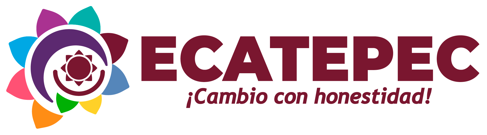

<div align="center">



# Innovación Gubernamental Ecatepec

**Sitio web de difusión para el área de Innovación Gubernamental del Palacio Municipal de Ecatepec, San Cristóbal.**

<p>
  
  
  
  
</p>

</div>

---

## 📌 Descripción

**Innovación Gubernamental Ecatepec** es un proyecto web que concentra y difunde la información del área de **Innovación Gubernamental del Palacio de Ecatepec**, ubicado en **San Cristóbal**.

El sitio integra contenidos de distintos medios —incluidas redes sociales como **TikTok** y **Facebook**— para que la ciudadanía encuentre en un solo lugar los programas, proyectos, convocatorias y noticias de la dependencia, sin tener que buscar entre varias plataformas.

> La información se presenta con una identidad visual institucional, accesible desde cualquier dispositivo y con navegación clara.

## 🎯 Objetivo

- Centralizar la información oficial del área de Innovación Gubernamental.
- Ampliar el alcance de las publicaciones que hoy viven en redes sociales.
- Facilitar el acceso de la ciudadanía a programas, convocatorias y resultados.
- Dar una imagen moderna, ordenada y confiable a la dependencia.

## ✨ Funcionalidades

| Sección | Descripción |
| --- | --- |
| 🏠 **Inicio** | Presentación del área y accesos rápidos a los programas. |
| 📊 **Indicadores** | Cifras de programas, ciudadanos atendidos y dependencias conectadas. |
| 🧩 **Programas** | Gobierno digital, datos abiertos, laboratorio de ideas y participación ciudadana. |
| 🚀 **Proyectos** | Iniciativas en marcha con resultados medibles. |
| 📰 **Noticias** | Convocatorias y avances del programa. |
| 📱 **Redes sociales** | Página de enlaces (linktree) con Facebook, TikTok y YouTube en `redes.html`. |
| 📬 **Contacto** | Medios oficiales de atención ciudadana. |

## 📱 Integración de redes sociales

| Plataforma | Uso dentro del sitio | Estado |
| --- | --- | --- |
| **TikTok** | Videos y campañas (`@sigecatepec`); feed integrado en el sitio. | ✅ Enlace en `redes.html` |
| **Facebook** | Publicaciones, transmisiones y avisos oficiales. | 🟡 URL por definir |
| **YouTube** | Transmisiones y videos institucionales. | 🟡 URL por definir |

**Enfoque técnico previsto**

- Incrustación de publicaciones mediante los embeds oficiales de cada plataforma.
- Uso de la API de Facebook Graph únicamente del lado del servidor.
- Las credenciales y tokens **nunca** se suben al repositorio (se manejan con variables de entorno).
- Solo se muestran cuentas oficiales verificadas.

## 🛠️ Stack tecnológico

- **Angular 22** — framework principal (standalone components, signals).
- **TypeScript 6** — tipado estricto.
- **Vitest** — pruebas unitarias.
- **Prettier** — formato de código.
- **HTML + CSS puro** en el mockup de diseño, sin dependencias externas.

## 📁 Estructura del proyecto

```text
innovacion_gubernamental_ecatepec/
├── mockup/                  # Prototipo navegable del sitio
│   ├── index.html           # Estructura y contenido
│   ├── styles.css           # Sistema de diseño (tokens de color, tipografía)
│   ├── redes.html           # Linktree: Facebook, TikTok y YouTube
│   ├── redes.css            # Estilos de la página de redes
│   └── assets/              # Logotipos e imágenes
├── public/                  # Recursos estáticos de Angular
├── src/
│   ├── app/
│   │   ├── app.ts           # Componente raíz
│   │   ├── app.html
│   │   ├── app.routes.ts    # Rutas de la aplicación
│   │   └── app.config.ts
│   ├── index.html
│   ├── main.ts
│   └── styles.css
├── angular.json
├── package.json
└── README.md
```

> **Nota:** el repositorio incluye el mockup completo y funcional en `mockup/`. La migración de ese diseño a componentes de Angular está en curso.

## 🚀 Cómo ejecutarlo

### Requisitos

- [Node.js](https://nodejs.org/) 20 o superior
- npm 11 o superior

### Instalación

```bash
git clone https://github.com/ulisesgezx/innovacion_gubernamental_ecatepec.git
cd innovacion_gubernamental_ecatepec
npm install
```

### Servidor de desarrollo

```bash
npm start
# o
ng serve
```

Abre `http://localhost:4200/`. La aplicación se recarga automáticamente al guardar cambios.

### Ver el mockup

No necesita instalación: abre `mockup/index.html` directamente en el navegador. La página de redes (linktree) está en `mockup/redes.html`.

### Compilar para producción

```bash
npm run build
```

Los archivos quedan en `dist/`.

### Pruebas

```bash
npm test
```

## 🎨 Diseño

El sistema de diseño vive en `mockup/styles.css` y se controla con variables CSS:

| Variable | Valor | Uso |
| --- | --- | --- |
| `--wine` | `#9F2241` | Color institucional principal |
| `--wine-dark` | `#7A1732` | Estados hover y énfasis |
| `--gold` | `#D9A441` | Acento y llamadas a la acción |
| `--plum` | `#1C0D12` | Fondos oscuros |
| `--cream` | `#F7F3F2` | Fondo general |
| `--ink` | `#241318` | Texto principal |

Tipografías: **Sora** para títulos e **Inter** para texto corrido.

## 🗺️ Roadmap

- [x] Mockup navegable y responsive
- [x] Sistema de diseño con paleta institucional
- [ ] Migración del mockup a componentes de Angular
- [ ] Integración de TikTok y Facebook
- [ ] Panel de administración de noticias y convocatorias
- [ ] Accesibilidad AA y pruebas en dispositivos reales
- [ ] Despliegue en producción

## 👤 Autor

**Ulises Gutiérrez Gómez** · [@ulisesgezx](https://github.com/ulisesgezx)

## 🎓 Contexto académico

Proyecto desarrollado en el marco de los estudios en la
**[Universidad Virtual del Estado de Guanajuato (UVEG)](https://www.uveg.edu.mx/)**,
aplicando conocimientos de desarrollo web al servicio de una necesidad real de difusión institucional.

## 🏛️ Institución

**Gobierno de Ecatepec** · Área de Innovación Gubernamental
Palacio Municipal, San Cristóbal, Ecatepec de Morelos, Estado de México.

---

<div align="center">

Hecho con 💜 para acercar el gobierno a la gente.

</div>
